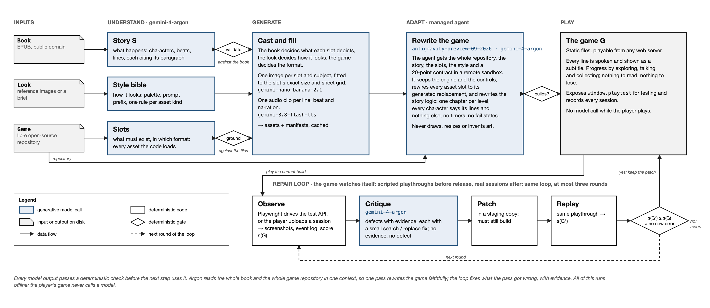
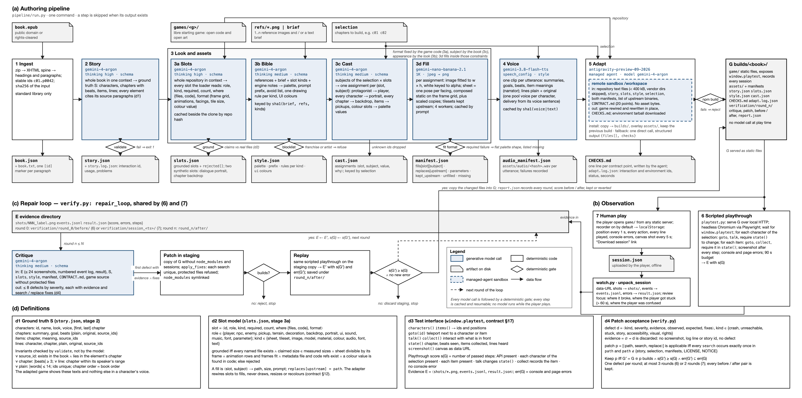

# ExpLit — MVP Plan

**Version:** 4.2 · **Event:** Gemini 4 Argon SF Hackathon · **Tracks:** More Dimensions (primary), Million Token Engineering (secondary)

> **Pitch:** My friend is dyslexic. She wants the story, not the page. ExpLit takes a book, a look, and an open-source game, and rewrites that game into one that tells the book's story, so she can hear it and play it instead of read it. The game watches itself: Argon reviews how it was played, finds bugs and places she got stuck, and fixes them between sessions.



The glance version. Section 3 has the detailed figure; both come from `docs/overview.py` and `docs/architecture.py`.

---

## 1. User and promise

**User:** a dyslexic reader, or anyone who cannot engage with a book but wants its story. Our first user is a real person: the author's friend.

**Promise:** pick a book, pick a look, pick a game to start from. Get a new game that tells that book. Hear every line and see it as you hear it. Never be asked to read to progress. Never be lied to about the book.

**Accessibility rules (non-negotiable, enforced by the verification loop):**

- Every line of dialogue and narration has generated audio and plays automatically.
- Every spoken line is also shown as a subtitle, word for word, while it plays. The subtitle stays until the player moves on.
- At most 12 words per subtitle. Plain language. The original sentence is available on demand, shown and read aloud.
- Dyslexia-friendly typography for subtitles: Atkinson Hyperlegible, large size, high contrast, generous letter and line spacing, short lines.
- No timers, no lives, no fail states. Progress is by exploring and talking.
- Characters never reveal what happens later in the book than where the player is.
- Every beat cites the paragraph it comes from. She cannot check the book, so the system must.

Not an education product. Not a chatbot. A game that tells a book's story.

---

## 2. Inputs and output

| Input | Form |
|---|---|
| Book | EPUB |
| Look | A short style brief, 1 to 3 reference images, or both |
| Game | A fully open-source browser game repository to start from: libre code and libre art. It contributes two things: the code we keep, and the **asset contract** we must fill (see section 3). First candidates: Veilspire, BrowserQuest. |

Examples: Veilspire rewritten for *Les Misérables*. A top-down creature-and-towns RPG rewritten for *Alice in Wonderland*.

**Rights rule:** we do not generate copyrighted assets. The book is public domain or rights-cleared. Style references are the user's own or rights-cleared. Generation prompts never name a franchise, a trademarked character, a studio, or a living artist. Generated characters, tiles, and voices are original designs described from the book's text and the style's palette, never lookalikes of existing games or films. The starting game lends its mechanics and code. Its art is replaced with generated art; libre-licensed upstream art (CC0, CC-BY, CC-BY-SA) may remain as a fallback with attribution. Nothing trademarked is ever a starting point.

**Output:** `builds/<book>_<game>/` containing a complete, book-specific game: rewritten source, generated images and audio, `story.json`, and `verification/` with before/after evidence. Playable from a local static server. No AI calls at play time; the game only records.

---

## 3. Pipeline



Source: `docs/architecture.py` (explicit geometry, no Mermaid). `uv run docs/architecture.py --render` regenerates `architecture.svg`, `architecture.png` and `architecture.pdf`; edit the script when the pipeline changes.

Four panels. **(a)** is the authoring pipeline, left to right: the external input above each stage, the artifact it writes below it, and between them the deterministic gate that can reject the output (`validate`, `ground`, the prompt blocklist, format fitting, `npm build`). Blue boxes are generative model calls with the model id in monospace; white boxes are deterministic code. Stage 3 is one container because its four calls answer three separate questions: the game code fixes what assets must exist and in what format (3a slots), the look fixes how they appear (3b bible), the book fixes what each one depicts (3c cast), and 3d fills inside those constraints. The dashed box in stage 5 is the Managed Agent sandbox: it receives repository text, the story, slots, style and selection files, the manifests and the contract, never asset bytes. **(b)** shows the two sources of evidence, the scripted Playwright playthrough and a real session uploaded by the player, both landing in the same evidence directory. **(c)** is the one repair loop shared by steps 6 and 7: critique, patch in staging, build, replay, and accept only if the playthrough score does not drop and no new console error appears; an accepted patch is copied into the build, which closes the ring. **(d)** states the four definitions the loop relies on: the ground-truth schema and its invariants, the slot model and its grounding rule, the `window.playtest` interface and score, and the patch acceptance rule. Argon reads the whole book once and the whole game repository twice, once to list its slots and once to rewrite it; everything below the build runs offline and the game never calls a model while she plays.

**Who decides what.** Three inputs, three separate authorities, and no step may take over another's job:

| Question | Decided by | Written to |
|---|---|---|
| What assets must exist, and in what exact format | the **game code**, read by Argon | `slots.json` |
| What each asset depicts | the **book**, via `story.json` | the casting in `assets/manifest.json` |
| How every asset looks | the **look**, via `style.json` | the generated files |

The game is not a bag of code with art to throw away. Its code defines a set of **slots**: every image, sheet, tile set, model, material, colour, sound, and font it loads, each with the format the engine requires. Those slots are constraints. The look does not change them; it fills them. The story decides which slot gets which character, place, or object. The Managed Agent never draws, resizes, or invents art: it rewires each slot to its filled replacement and rewrites the story logic. A game with procedural art has slots too: its parameters (colours, materials, shapes) are slots filled with values from the palette instead of files.

**[1] Ingest.** EPUB is a zip of XHTML: unzip with the standard library, strip tags, split chapters by spine order, number paragraphs as `c01.p0042`. Alice in Wonderland from `ressources/` is the demo book. PDF comes later.

**[2] Story.** One Argon call, whole book in context, JSON schema output, thinking high. Produces `story.json`:

- `characters[]`: id, name, look (one sentence), voice (one sentence), first and last chapter. Lines are per chapter, so a character cannot speak outside the chapters it appears in.
- `chapters[]` → `beats[]`: one plain-language sentence, the original sentence, source paragraph ids.
- `items[]`: id, name, chapter, one-sentence meaning.
- `lines[]` per character per chapter: 2 to 4 plain-language lines plus the quoted original where one exists, each with source ids.

`story.json` is the ground truth. The adapted game must contain exactly these characters, beats, and lines. The critique step checks the game against it.

**[3a] Slots.** One Argon call over the whole game repository, JSON schema output, before anything is styled. It lists every asset the game loads, as `slots.json`:

- `id`, `role` (player, npc, enemy, pickup, terrain, decoration, backdrop, ui, sound, font, parameter), `kind` (sheet, tile set, single image, model, material, colour, audio, text value), and whether the slot is required for the game to run.
- `format`: file type, frame width and height, sheet grid, named animations with row and frame count, facings, anchor or offset, tile size, aspect ratio, or for a parameter its type and current value. Whatever the engine's loader actually reads.
- `where`: the upstream file paths and the code locations (file and line) that reference them.
- `count`: how many instances of this slot the game can place, so casting knows how many characters or items fit.

`slots.py` then grounds every slot against the real repository: it opens each named file and checks the claimed dimensions, grid, and format. A slot whose claim does not match the file is rejected, like a critique defect without evidence. Slots are derived from the code, never typed by hand: adding a game to the pipeline means cloning it, not writing a conventions table.

**[3b] Style bible.** Argon reads the brief and the reference images together with `slots.json` and writes `style.json`: a name, a palette, a prompt prefix, an avoid list, and one rendering rule per slot kind present in this game (how a character frame is framed and anchored, how a tile reads next to its neighbours, how an item sits in its frame, how a backdrop keeps a ground plane). The rules describe the look inside the constraint; they never change the constraint. The bible is keyed by the hash of brief, reference names, and `slots.json`, and is regenerated when any of them changes. A new brief must always produce a new look.

**[3c] Fill the slots.** For the selected chapters, Argon casts `story.json` into `slots.json` and writes `cast.json`: each character into a character slot, each chapter into a backdrop or terrain slot, each item into a pickup slot, the narrator and UI colours into parameter slots. Two slots exist for every game even when upstream has nothing like them, added by the adapter: a **dialogue portrait** shown beside each spoken line and a **chapter backdrop** shown when a chapter opens. They carry the look into games whose art is procedural, where the only other slots are colour parameters. Then Nano Banana 2.1 generates to each slot's exact format. Sheets in the MVP are **static**: one pose per facing, generated from the same subject sentence, fitted to the frame and repeated across that facing's animation rows, with every scaled copy upstream has; animated frames are a stretch goal. Tile sets are **kept from upstream** by default, since they are libre and attributed, and a flag tiles one generated texture instead. Single images are resized, padded, anchored, and keyed out. Every output is checked against the slot's format before it enters `assets/manifest.json`, which records, per slot and subject: the prompt, the output path, the verified size, which upstream file it replaces, and any degradation. A required slot that could not be filled is filled by us with a flat shape in the palette and listed under `missing`, so the agent never has to draw. Prompts are built from the prefix, the slot's rule, the subject's sentence from `story.json`, the facing, and the avoid list only. `style.py` rejects any prompt containing a name from a short blocklist of franchises and characters.

**[4] Voice.** Gemini 3.8 Flash TTS, one voice per character chosen from the character's voice sentence, one narrator voice for beats. One audio file per line, cached by text hash, listed in `assets/audio_manifest.json`.

**[5] Adapt.** The core step. The Antigravity Managed Agent, with Argon as its model, gets the whole starting repository, `story.json`, `slots.json`, `style.json`, the filled asset manifest, the audio manifest, and the adaptation contract below. Its art job is rewiring, not art: every slot in `slots.json` is either pointed at its filled replacement from the manifest or removed, together with the code that placed it. It rewrites the game in its sandbox, runs the build, and returns the new repository. We pull it into `builds/`, run the build ourselves, and reject it if it does not start.

The adaptation contract, included in the prompt and checked afterwards:

- The game's levels, areas, or regions follow the book's chapter order. One chapter is one unit.
- Every character in `story.json` appears, says its lines from `story.json`, and nothing else.
- Every beat is reachable by playing. Each chapter has a clear goal that ends it.
- Every slot in `slots.json` is rewired to the replacement named for it in the manifest, or removed with the code that placed it. No upstream art, name, or sound remains. The agent does not resize, crop, recolour, or draw; an asset that is missing is reported in `CHECKS.md`, not improvised. Loader code and metadata formats stay as they were so the filled files drop in.
- UI colours, subtitle box, menus, and any procedural parameter slot take their values from the `style.json` palette, so the game's chrome matches the art.
- Subtitles and audio playback for every line, with the typography rules above.
- No timers, lives, or death. Combat, if the game has it, does no damage.
- A `window.playtest` API: list characters and items, teleport to one, trigger talk and collect, dump state, screenshot the canvas.
- A session recorder, on by default: position every second, every action, every line played, console errors, and a canvas screenshot every 5 seconds, written to `sessions/<timestamp>/` as the game runs.
- The game runs from a static folder. If the starting game needs a server, one documented `npm start`.

**[6] Verify loop.** Playwright opens the build headless and drives `window.playtest`: visit every character, talk, collect every item, reach each chapter's goal. It records screenshots, console errors, and a state log. Argon receives these plus `story.json`, `slots.json`, `style.json`, the accessibility rules, and the adaptation contract, and returns a JSON list of defects with evidence plus a fix. Visual defects are judged against the slots and the bible: a sprite facing the wrong way, an anchor off the ground, an upstream sheet still loaded, a UI colour outside the palette. Fixes are small diffs to the adapted game, applied in a staging copy. The build must still start and the same playtest script must pass with the defect gone and no new failures. Otherwise revert. At most 3 rounds. Keep every before/after pair. Any defect without a screenshot, log line, or `story.json` citation is rejected.

**[7] Watch.** After a real session, `watch.py` hands the recording to Argon: the screenshots in order, the event log, `story.json`, and the accessibility rules. Argon answers three questions with evidence: where did the game break (errors, missing audio, unreachable goal), where did the player get stuck (no progress for more than 60 seconds, repeated actions, backtracking), and where was the player confused (same character talked to many times, item never found). Each finding becomes a defect with a proposed fix and goes through the exact same staging, replay, accept-or-revert path as step 6. This runs offline, never during play. The next time she opens the game, the fix is in. Long sessions are also the place where long video understanding earns its keep: a recording can be stitched into one video and given to Argon whole.

---

## 4. Starting games

Each is a starting point only. Nothing is reused across books except the repository itself, cloned fresh every time. Only fully open-source games qualify: libre code **and** libre art. Clones of trademarked games are out even when their code is MIT.

| Game | Repo | Stack | License | What the book becomes | Watch out |
|---|---|---|---|---|---|
| Veilspire | Lunaneco/veilspire | Three.js, procedural assets | MIT (checked 25 Oct 2026) | One region per chapter; dialogue carries beats; quest chain follows chapters | Large repo (~44 MB); clone shallow. |
| BrowserQuest | ericthefree/BrowserQuest (single-player fork of mozilla/BrowserQuest) | HTML5 canvas, JS, small Node server | MPL 2.0 code, CC-BY-SA 3.0 art | One zone per chapter; NPCs are characters; quests are beats | Needs its server or an offline mode; art replaced, libre art may stay as fallback with attribution. |
| Flare: Empyrean Campaign | flareteam/flare-engine + flare-game, browser port dtqyai/flare-web | C++ engine compiled to WebAssembly; INI-style data mods | GPLv3 engine, CC-BY-SA 3.0 art | A new campaign mod: maps, NPC dialogue, quests, items | **Stretch only.** Needs the Emscripten SDK, a full engine build, 619 MiB of resources, and has no JavaScript API, so the playtest hook and the verify loop do not apply. Argon would write mod data, not code. |

**Order:** Veilspire first: MIT, procedural art so there is nothing to delete, one `npm run build`. Then BrowserQuest, which needs its server or an offline mode. The MVP ships every build that passes the verify loop.

---

## 5. Models

| Job | Model |
|---|---|
| Story, style reading, critique | `gemini-4-argon` (thinking high for story, medium elsewhere) |
| Adapt: rewrite the game | `antigravity-preview-09-2026` with `agent_config.model = gemini-4-argon`, fallback direct `gemini-4-argon` |
| Images: characters, backdrops, tiles, items | `gemini-nano-banana-2.1` |
| Voice for every line | `gemini-3.8-flash-tts` |

All calls go through the Interactions API with `google-genai`. Model ids live in `pipeline/config.py`. Consult `.agents/skills/gemini-api-dev/SKILL.md` and the linked doc page before writing each call.

**Cutscenes:** a chapter opens on its backdrop with the narrator reading the first beat, subtitled. Video clips (`gemini-omni-1.1-flash`) are a stretch goal and never block play.

---

## 6. Dependencies

- Python 3.12 via `uv`: `google-genai`, `python-dotenv`, `playwright` (plus `playwright install chromium`).
- Node only as the starting game requires. No bundler of our own.
- Standard library for EPUB, JSON, hashing, and the static server.
- No database, no web framework, no cloud deploy. The demo runs from `python -m http.server`.

---

## 7. Repository layout

```text
README.md
PLAN.md
pipeline/
  config.py        model ids, paths
  ingest.py        epub -> book.json + book.txt
  story.py         book -> story.json (Argon, whole book)
  slots.py         game repo -> slots.json (Argon reads the code), grounded against the real files
  style.py         brief or reference images + slots.json -> style.json, cast.json, filled slots (Nano Banana)
  voice.py         every line -> wav (TTS), cached by hash
  adapt.py         game repo + story + style + assets -> rewritten game (Managed Agent; --fallback = direct Argon)
  playtest.py      serve a game, drive window.playtest with Playwright, record evidence
  verify.py        playthrough -> Argon critique -> search/replace patch -> replay, keep or revert
  watch.py         real session log -> same critique and patch loop
  run.py           one command, all steps, resumable
  smoke.py         four API smoke tests
schema/            story, slots, style, cast, critique JSON schemas
prompts/           story.md, slots.md, adapt_contract.md, critique.md
tests/             fixture_game/ + test_backend.py (no model calls)
games/             upstream clones, untouched, with their licenses (gitignored)
builds/<book>/
  book.json  story.json  slots.json  style.json  cast.json  selection.json
  assets/          one folder per slot role, audio/, + manifests (slot -> subject, prompt, verified format)
  game/            the rewritten game, records sessions to localStorage
  verification/    round_N/{critique,patch}.json, before/after shots, report.json
ressources/        input books and style references
poc/               pre-event prototype, not hackathon work
```

Every generated file records the model, interaction id, and input hashes. Commit code, schemas, prompts, one complete Alice build with small assets, and the verification evidence. Never commit `.env`.

---

## 8. Build order

Dependency order only. Each step has a check that must pass before the next.

1. **Smoke tests.** One Argon JSON call, one Nano Banana image, one TTS clip, one Managed Agent run that returns a file. Check: four files on disk.
2. **Ingest Alice.** Check: 12 chapters, stable paragraph ids, hash recorded.
3. **story.json.** Check: validates; every beat's source ids resolve; no character knows a later beat.
4. **Slots for the starting game.** Check: `slots.json` validates; every slot's claimed format matches the real upstream file, mismatches are listed under `rejected`; at least one slot per role the engine actually has is found without any hand-written table; the two synthetic slots are present.
5. **Assets and voice for Alice.** Check: every required slot for the selected chapters is filled with a file of the slot's exact format, cast from `story.json`; every line has audio; manifests list them; changing the brief changes the output.
6. **Adapt Veilspire for Alice.** Check: the build starts, `window.playtest` works, every character from `story.json` is present and speaks its lines with subtitle and audio, no lives or timer, no upstream sprite left.
7. **Verify loop.** Check: at least one real defect found with evidence, fixed, replayed, and improved, with the build still starting. Report saved.
8. **Watch.** Play a real session, get stuck on purpose once. Check: `watch.py` finds the stuck point with a screenshot, proposes a fix, the fix passes replay, and the next launch has it.
9. **README and demo build.** Check: a stranger can run it from the README.
10. **Second book, second game.** Same checks as 3 to 8.
11. **Optional:** one Omni chapter clip. A third game.

Never let steps 10 or 11 break a passing build from step 9.

---

## 9. Demo (3 minutes, live, no slides)

1. **The user.** Twenty seconds on my friend. If she has played it, fifteen seconds of her playing.
2. **Inputs.** Show the Alice EPUB, the style images, and Veilspire running as it came from GitHub.
3. **Play the result.** The same game, now Alice. Walk to the White Rabbit. He speaks aloud, subtitled. Collect the key. The narrator reads the beat. Show the source paragraph behind it.
4. **The game watches itself, live.** Play for thirty seconds and get stuck somewhere. Run `watch.py`. Show the screenshot Argon saw, the stuck point it cited, the diff it wrote, and the replay passing. This is the real-input, real-verification moment.
5. **Why Argon.** One sentence: the whole book and the whole game repository fit in one context, so one pass rewrites a game faithfully and consistently, and the loop fixes what the pass got wrong.

Keep a screen recording as backup. Reset state before each judge.

---

## 10. Rules compliance

- Repo public. Alice is public domain. Every image and sound is original and generated by us from the book's text and the user's style. No prompt names a franchise, character, or artist. Starting game licenses are kept and attributed; upstream art is deleted, not restyled.
- `poc/` and the clones in `games/` are pre-existing. Everything in `pipeline/`, `prompts/`, `schema/`, and `builds/` is hackathon work, and the git history shows it.
- Not on the banned list: not education, not a chatbot, not a dashboard, not an image analyzer as a product.

---

## 11. Risks

| Risk | Fallback |
|---|---|
| Adapted game does not build or start | Reject, show the agent the build error, retry once. Then try a smaller starting game. |
| Whole-repo adaptation drifts from `story.json` | The critique step diffs the game's lines against `story.json` and fixes mismatches first. |
| Managed Agent cannot return the repo | Direct Argon call that outputs the full file set; say so in the report. |
| Generated assets do not fit a slot | Cannot happen silently: the fill step checks every output against the slot's format before it enters the manifest. On failure: regenerate once, then a Nano Banana edit pass, then a flat palette shape listed under `missing`. |
| Argon misreads the game's asset formats | `slots.py` grounds every claim against the real file and rejects mismatches; a game whose loader cannot be read gets its slots from a manual `slots.json` committed next to the clone, flagged as such. |
| Argon critique invents a defect | Reject any defect without evidence. |
| A fix regresses the playthrough | Revert; keep the known-good build; record the rejection. |
| Session recordings grow large | Screenshot every 5 seconds at low resolution; keep the last 10 sessions. |
