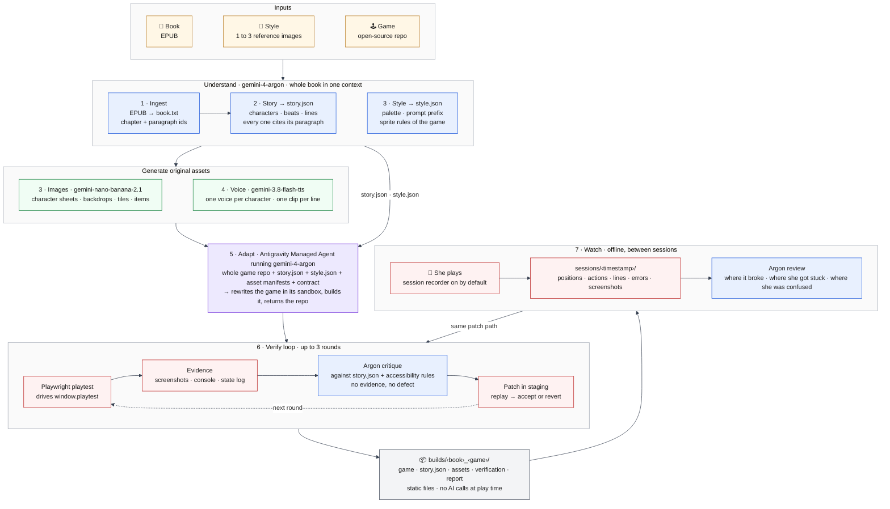

# Storyworld — MVP Plan

**Version:** 4.0 · **Event:** Gemini 4 Argon SF Hackathon · **Tracks:** More Dimensions (primary), Million Token Engineering (secondary)

> **Pitch:** My sister is dyslexic. She wants the story, not the page. Storyworld takes a book, a look, and an open-source game, and rewrites that game into one that tells the book's story, so she can hear it and play it instead of read it. The game watches itself: Argon reviews how it was played, finds bugs and places she got stuck, and fixes them between sessions.

---

## 1. User and promise

**User:** a dyslexic reader, or anyone who cannot engage with a book but wants its story. Our first user is a real person: the author's sister.

**Promise:** pick a book, pick a look, pick a game to start from. Get a new game that tells that book. Hear every line and see it as you hear it. Never be asked to read to progress. Never be lied to about the book.

**Accessibility rules (non-negotiable, enforced by the verification loop):**

- Every line of dialogue and narration has generated audio and plays automatically.
- Every spoken line is also shown as a subtitle, word for word, while it plays. The subtitle stays until the player moves on.
- At most 12 words per subtitle. Plain language. The original sentence is available on demand, shown and read aloud.
- Dyslexia-friendly typography for subtitles: Atkinson Hyperlegible, large size, high contrast, generous letter and line spacing, short lines.
- No timers, no lives, no fail states. Progress is by exploring and talking.
- Characters never reveal what happens later in the book than where the player is.
- Every beat cites the paragraph it comes from. She cannot check the book, so the system must.

Not an education product. Not a chatbot. A game that tells a book's story.

---

## 2. Inputs and output

| Input | Form |
|---|---|
| Book | EPUB |
| Style | 1 to 3 reference images |
| Game | An open-source game repository to start from. First candidates: BrowserQuest, Super Mario Phaser, Veilspire. Any browser game with a clear license works. |

Examples: Veilspire rewritten for *Les Misérables*. A top-down creature-and-towns RPG rewritten for *Alice in Wonderland*.

**Rights rule:** we do not generate copyrighted assets. The book is public domain or rights-cleared. Style references are the user's own or rights-cleared. Generation prompts never name a franchise, a trademarked character, a studio, or a living artist. Generated characters, tiles, and voices are original designs described from the book's text and the style's palette, never lookalikes of existing games or films. The starting game lends its mechanics and code, not its art or its names.

**Output:** `builds/<book>_<game>/` containing a complete, book-specific game: rewritten source, generated images and audio, `story.json`, and `verification/` with before/after evidence. Playable from a local static server. No AI calls at play time; the game only records.

---

## 3. Pipeline



Read it top to bottom. Blue boxes are Argon reading or judging; purple is the Managed Agent rewriting the game; green is asset generation; red is the two loops. Argon reads the whole book once and the whole game repository once, which is what lets one pass rewrite a game faithfully. Everything below the build runs offline. The verify loop and the watch step share one patch path: evidence in, small diff out, replay, accept or revert.

**[1] Ingest.** EPUB is a zip of XHTML: unzip with the standard library, strip tags, split chapters by spine order, number paragraphs as `c01.p0042`. Alice in Wonderland from `ressources/` is the demo book. PDF comes later.

**[2] Story.** One Argon call, whole book in context, JSON schema output, thinking high. Produces `story.json`:

- `characters[]`: id, name, look (one sentence), voice (one sentence), first and last chapter. Lines are per chapter, so a character cannot speak outside the chapters it appears in.
- `chapters[]` → `beats[]`: one plain-language sentence, the original sentence, source paragraph ids.
- `items[]`: id, name, chapter, one-sentence meaning.
- `lines[]` per character per chapter: 2 to 4 plain-language lines plus the quoted original where one exists, each with source ids.

`story.json` is the ground truth. The adapted game must contain exactly these characters, beats, and lines. The critique step checks the game against it.

**[3] Style.** Argon looks at the reference images and writes `style.json`: palette, a prompt prefix, and sprite conventions matching the starting game (tile size, view angle, sheet layout). Nano Banana 2.1 then generates, in this order: one sheet per character, one backdrop or tileset per chapter, items. Reuse the character sheet as a reference image in every later generation so characters stay consistent. Prompts are built from the character's look sentence, the style palette, and the sprite conventions only. `style.py` rejects any prompt containing a name from a short blocklist of franchises and characters. Record every prompt and output path in `assets/manifest.json`.

**[4] Voice.** Gemini 3.8 Flash TTS, one voice per character chosen from the character's voice sentence, one narrator voice for beats. One audio file per line, cached by text hash, listed in `assets/audio_manifest.json`.

**[5] Adapt.** The core step. The Antigravity Managed Agent, with Argon as its model, gets the whole starting repository, `story.json`, `style.json`, the asset and audio manifests, and the adaptation contract below. It rewrites the game in its sandbox, runs the build, and returns the new repository. We pull it into `builds/`, run the build ourselves, and reject it if it does not start.

The adaptation contract, included in the prompt and checked afterwards:

- The game's levels, areas, or regions follow the book's chapter order. One chapter is one unit.
- Every character in `story.json` appears, says its lines from `story.json`, and nothing else.
- Every beat is reachable by playing. Each chapter has a clear goal that ends it.
- All upstream art, names, and sounds are removed. Only generated assets from the manifest are used.
- Subtitles and audio playback for every line, with the typography rules above.
- No timers, lives, or death. Combat, if the game has it, does no damage.
- A `window.playtest` API: list characters and items, teleport to one, trigger talk and collect, dump state, screenshot the canvas.
- A session recorder, on by default: position every second, every action, every line played, console errors, and a canvas screenshot every 5 seconds, written to `sessions/<timestamp>/` as the game runs.
- The game runs from a static folder. If the starting game needs a server, one documented `npm start`.

**[6] Verify loop.** Playwright opens the build headless and drives `window.playtest`: visit every character, talk, collect every item, reach each chapter's goal. It records screenshots, console errors, and a state log. Argon receives these plus `story.json`, the accessibility rules, and the adaptation contract, and returns a JSON list of defects with evidence plus a fix. Fixes are small diffs to the adapted game, applied in a staging copy. The build must still start and the same playtest script must pass with the defect gone and no new failures. Otherwise revert. At most 3 rounds. Keep every before/after pair. Any defect without a screenshot, log line, or `story.json` citation is rejected.

**[7] Watch.** After a real session, `watch.py` hands the recording to Argon: the screenshots in order, the event log, `story.json`, and the accessibility rules. Argon answers three questions with evidence: where did the game break (errors, missing audio, unreachable goal), where did the player get stuck (no progress for more than 60 seconds, repeated actions, backtracking), and where was the player confused (same character talked to many times, item never found). Each finding becomes a defect with a proposed fix and goes through the exact same staging, replay, accept-or-revert path as step 6. This runs offline, never during play. The next time she opens the game, the fix is in. Long sessions are also the place where long video understanding earns its keep: a recording can be stitched into one video and given to Argon whole.

---

## 4. Starting games

Each is a starting point only. Nothing is reused across books except the repository itself, cloned fresh every time.

| Game | Repo | Stack | License | What the book becomes | Watch out |
|---|---|---|---|---|---|
| Super Mario Phaser | pablogozalvez/Super-Mario-Phaser | Phaser 3, static | MIT code; sprites are Nintendo's | One level per chapter; characters are talk points; items are collectibles | Every sprite and tile deleted and regenerated. Nothing may resemble Mario. |
| BrowserQuest | mozilla/BrowserQuest or a single-player fork | HTML5 canvas, Node server | MPL 2.0 code, CC-BY-SA 3.0 art | One zone per chapter; NPCs are characters; quests are beats | Server adds friction; prefer the single-player fork. Art replaced. |
| Veilspire | Lunaneco/veilspire | Three.js, procedural assets | MIT (checked 25 Oct 2026) | One region per chapter; dialogue carries beats; quest chain follows chapters | Large repo (~44 MB); clone shallow. |

**Order:** Super Mario Phaser first because it is static and smallest. Then the one that fits the second book best. The MVP ships every build that passes the verify loop.

---

## 5. Models

| Job | Model |
|---|---|
| Story, style reading, critique | `gemini-4-argon` (thinking high for story, medium elsewhere) |
| Adapt: rewrite the game | `antigravity-preview-09-2026` with `agent_config.model = gemini-4-argon`, fallback direct `gemini-4-argon` |
| Images: characters, backdrops, tiles, items | `gemini-nano-banana-2.1` |
| Voice for every line | `gemini-3.8-flash-tts` |

All calls go through the Interactions API with `google-genai`. Model ids live in `pipeline/config.py`. Consult `.agents/skills/gemini-api-dev/SKILL.md` and the linked doc page before writing each call.

**Cutscenes:** a chapter opens on its backdrop with the narrator reading the first beat, subtitled. Video clips (`gemini-omni-1.1-flash`) are a stretch goal and never block play.

---

## 6. Dependencies

- Python 3.12 via `uv`: `google-genai`, `python-dotenv`, `playwright` (plus `playwright install chromium`).
- Node only as the starting game requires. No bundler of our own.
- Standard library for EPUB, JSON, hashing, and the static server.
- No database, no web framework, no cloud deploy. The demo runs from `python -m http.server`.

---

## 7. Repository layout

```text
README.md
PLAN.md
pipeline/
  config.py        model ids, paths
  ingest.py        epub -> book.json + book.txt
  story.py         book -> story.json (Argon, whole book)
  style.py         brief or reference images -> style.json, then images (Nano Banana)
  voice.py         every line -> wav (TTS), cached by hash
  adapt.py         game repo + story + style + assets -> rewritten game (Managed Agent; --fallback = direct Argon)
  playtest.py      serve a game, drive window.playtest with Playwright, record evidence
  verify.py        playthrough -> Argon critique -> search/replace patch -> replay, keep or revert
  watch.py         real session log -> same critique and patch loop
  run.py           one command, all steps, resumable
  smoke.py         four API smoke tests
schema/            story, style, critique JSON schemas
prompts/           story.md, adapt_contract.md, critique.md
tests/             fixture_game/ + test_backend.py (no model calls)
games/             upstream clones, untouched, with their licenses (gitignored)
builds/<book>/
  book.json  story.json  style.json  selection.json
  assets/          characters/ backdrops/ items/ audio/ + manifests
  game/            the rewritten game, records sessions to localStorage
  verification/    round_N/{critique,patch}.json, before/after shots, report.json
ressources/        input books and style references
poc/               pre-event prototype, not hackathon work
```

Every generated file records the model, interaction id, and input hashes. Commit code, schemas, prompts, one complete Alice build with small assets, and the verification evidence. Never commit `.env`.

---

## 8. Build order

Dependency order only. Each step has a check that must pass before the next.

1. **Smoke tests.** One Argon JSON call, one Nano Banana image, one TTS clip, one Managed Agent run that returns a file. Check: four files on disk.
2. **Ingest Alice.** Check: 12 chapters, stable paragraph ids, hash recorded.
3. **story.json.** Check: validates; every beat's source ids resolve; no character knows a later beat.
4. **Assets and voice for Alice.** Check: every character, chapter, and item has an image; every line has audio; manifests list them.
5. **Adapt Super Mario Phaser for Alice.** Check: the build starts, `window.playtest` works, every character from `story.json` is present and speaks its lines with subtitle and audio, no lives or timer, no upstream sprite left.
6. **Verify loop.** Check: at least one real defect found with evidence, fixed, replayed, and improved, with the build still starting. Report saved.
7. **Watch.** Play a real session, get stuck on purpose once. Check: `watch.py` finds the stuck point with a screenshot, proposes a fix, the fix passes replay, and the next launch has it.
8. **README and demo build.** Check: a stranger can run it from the README.
9. **Second book, second game.** Same checks as 3 to 7.
10. **Optional:** one Omni chapter clip. A third game.

Never let steps 9 or 10 break a passing build from step 8.

---

## 9. Demo (3 minutes, live, no slides)

1. **The user.** Twenty seconds on my sister. If she has played it, fifteen seconds of her playing.
2. **Inputs.** Show the Alice EPUB, the style images, and the starting game running as it came from GitHub.
3. **Play the result.** The same game, now Alice. Walk to the White Rabbit. He speaks aloud, subtitled. Collect the key. The narrator reads the beat. Show the source paragraph behind it.
4. **The game watches itself, live.** Play for thirty seconds and get stuck somewhere. Run `watch.py`. Show the screenshot Argon saw, the stuck point it cited, the diff it wrote, and the replay passing. This is the real-input, real-verification moment.
5. **Why Argon.** One sentence: the whole book and the whole game repository fit in one context, so one pass rewrites a game faithfully and consistently, and the loop fixes what the pass got wrong.

Keep a screen recording as backup. Reset state before each judge.

---

## 10. Rules compliance

- Repo public. Alice is public domain. Every image and sound is original and generated by us from the book's text and the user's style. No prompt names a franchise, character, or artist. Starting game licenses are kept and attributed; upstream art is deleted, not restyled.
- `poc/` and the clones in `games/` are pre-existing. Everything in `pipeline/`, `prompts/`, `schema/`, and `builds/` is hackathon work, and the git history shows it.
- Not on the banned list: not education, not a chatbot, not a dashboard, not an image analyzer as a product.

---

## 11. Risks

| Risk | Fallback |
|---|---|
| Adapted game does not build or start | Reject, show the agent the build error, retry once. Then try a smaller starting game. |
| Whole-repo adaptation drifts from `story.json` | The critique step diffs the game's lines against `story.json` and fixes mismatches first. |
| Managed Agent cannot return the repo | Direct Argon call that outputs the full file set; say so in the report. |
| Generated sprites do not fit the game's tile size | Fix sizes in `style.json`; regenerate; Nano Banana edit pass. |
| Argon critique invents a defect | Reject any defect without evidence. |
| A fix regresses the playthrough | Revert; keep the known-good build; record the rejection. |
| Session recordings grow large | Screenshot every 5 seconds at low resolution; keep the last 10 sessions. |
