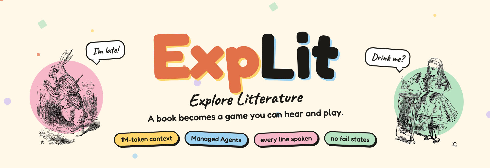
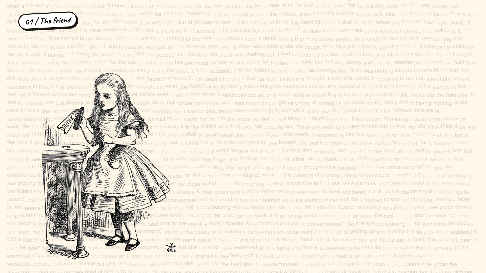
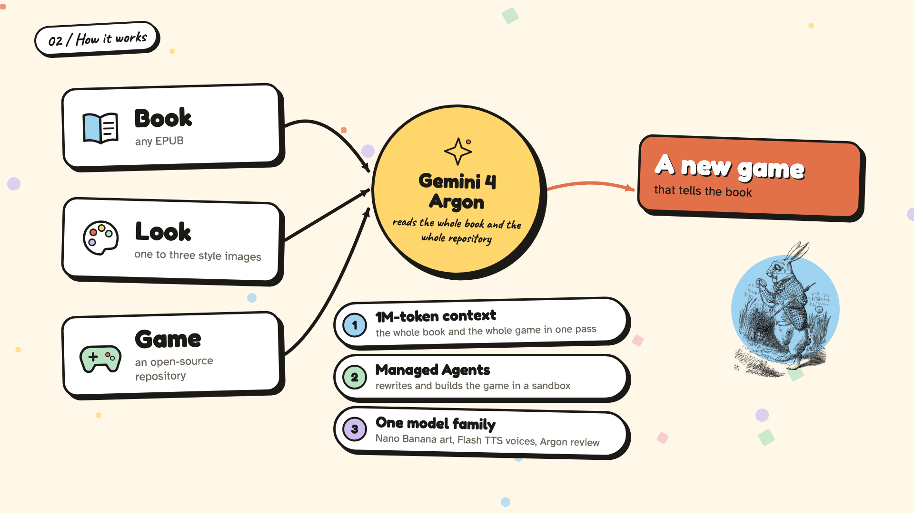
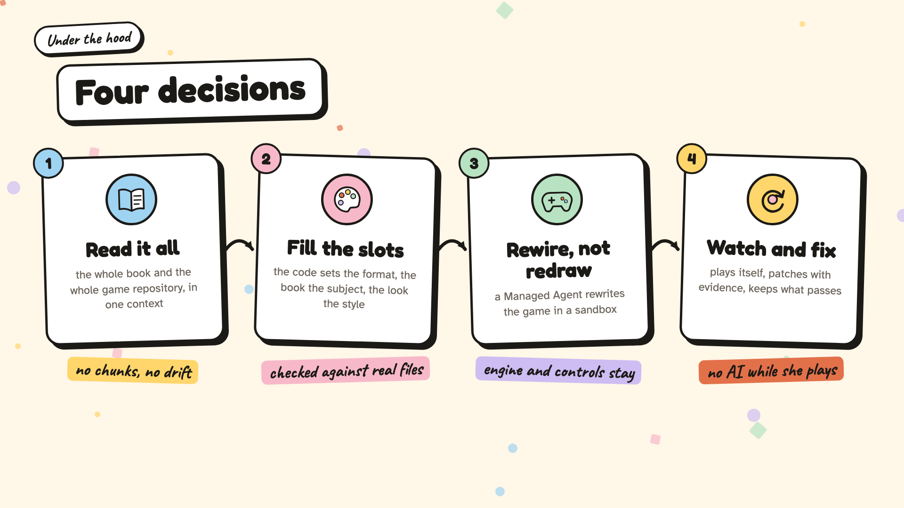
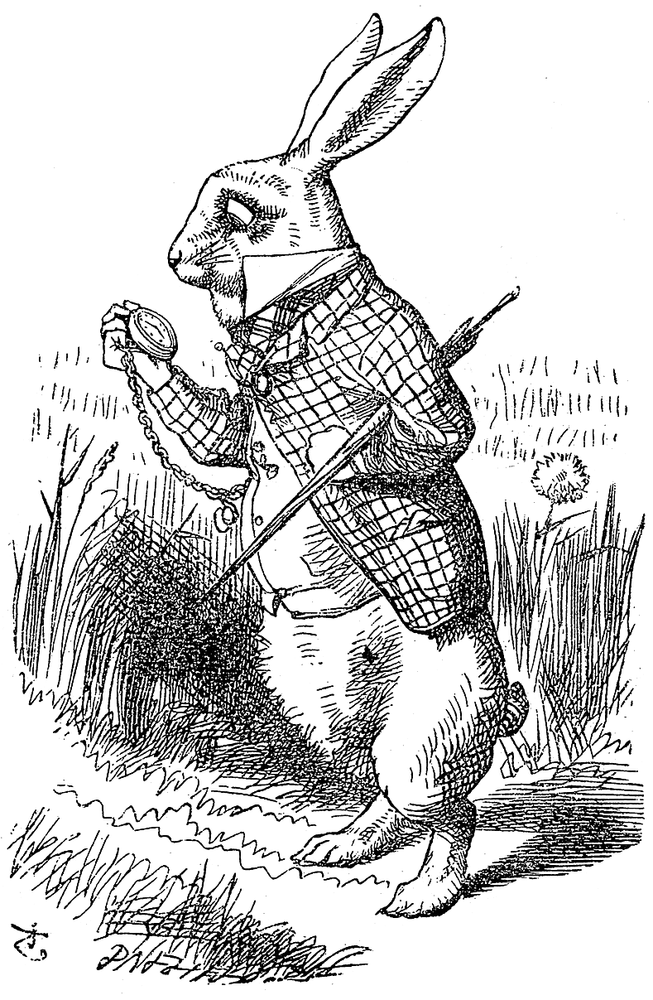
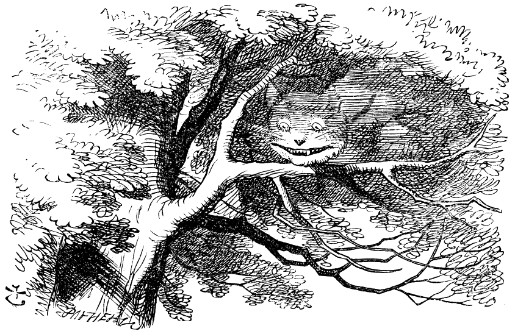

<p align="center">
  
</p>

<p align="center">
  
  
  
  
</p>

<p align="center"><i>Built in a day at the Gemini 4 Argon SF Hackathon · 25 Oct 2026 · see <a href="PLAN.md">PLAN.md</a></i></p>

---

## 📖 "What is the use of a book without pictures or conversations?"



My best friend is dyslexic. A page is a wall. **A story is not.**

So ExpLit turns the wall into a world. You give it **a book**, **a look** and **an open-source game**, and you get back a new game that tells the book's story. Every line is spoken *and* subtitled. Nothing times you, nothing kills you, and you can't fail. And the game watches how it was played, so Gemini 4 Argon can come back later and fix whatever broke.

## 🎩 How the trick works



Argon reads **the whole book and the whole game repository in one go**: a million tokens, no chunks, no drift. Then a Managed Agent rewires the game in a sandbox and hands back the repo.



| Who | Does what |
|---|---|
| 🧠 `gemini-4-argon` | pulls the story out of the whole book, writes the style bible, reviews play sessions |
| 🛠️ `antigravity-preview-09-2026` running `gemini-4-argon` | rewrites the game |
| 🎨 `gemini-nano-banana-2.1` | draws every character, backdrop and item |
| 🗣️ `gemini-3.8-flash-tts` | gives every line a voice |

## 🫖 Down the rabbit hole (setup)



1. `cp .env.example .env` and paste your key from https://aistudio.google.com/api-keys
2. `uv sync && uv run playwright install chromium-headless-shell`
3. `uv run pipeline/smoke.py` runs four API checks: Argon JSON, image, speech, Managed Agent.
4. `uv run tests/test_backend.py` runs the tests that need no model: parser, patcher, packing, Playwright driver.

*Oh dear! Oh dear! I shall be late!* Four `ok` lines from the smoke test and you're through the little door.

<br clear="right">

## 🍄 Eat me (run it)

**In the browser:** `uv run server.py`, then open http://127.0.0.1:8765. Pick a book, chapters, a style and a game. Build it, play it, and upload a session for review.

**From the command line:**

```bash
git clone --depth 1 https://github.com/Lunaneco/veilspire games/veilspire
uv run pipeline/run.py ressources/alice_in_wonderland.epub --game veilspire \
    --chapters c01 c02 --brief "soft watercolour storybook, gentle ink lines, pastel greens and gold"
```

Steps run in this order: **ingest → story → style → voice → adapt → verify**. A step is skipped when its output already exists. Use `--only` or `--force` to choose which steps run, `--fallback` to adapt with a direct Argon call instead of the Managed Agent, and `--refs ressources/style` to take the style from reference images.

## 🃏 Play, then let the game watch itself

```bash
cd builds/<book>/game && python -m http.server 8000
```

The page has a **Download session** link. Feed that file back and Argon finds where the game broke and where the player got stuck:

```bash
uv run pipeline/watch.py builds/<book> session.json
```

The fix is in before the next launch. It all happens offline, between sessions: no AI calls while someone is playing.

## 😼 We're all honest here (rights)



- **Books** are public domain or rights-cleared.
- **Every image and sound** is generated from the book's text and the user's style. Prompts that name a franchise or an artist are refused.
- **Starting games** are fully open source (libre code *and* libre art) and keep their licenses. Their art is replaced with generated art.
- The illustrations in this README are Tenniel's 1865 drawings, public domain worldwide. Sources are in [video/public/pd/CREDITS.md](video/public/pd/CREDITS.md).

<br clear="right">

## 🕰️ Provenance

`poc/` and `games/` existed before the event. Everything in `pipeline/`, `prompts/`, `schema/`, `tests/` and `builds/` was written during it.

## 🎬 The pitch video

[`video/`](video/) is a Remotion project with two cuts of the explainer: a lean one, and a playful scrapbook one that all the pictures above come from. See [video/README.md](video/README.md). To refresh the README art, run `cd video && npm run readme`.

<p align="center"><b><i>Every story, for everyone.</i></b></p>
